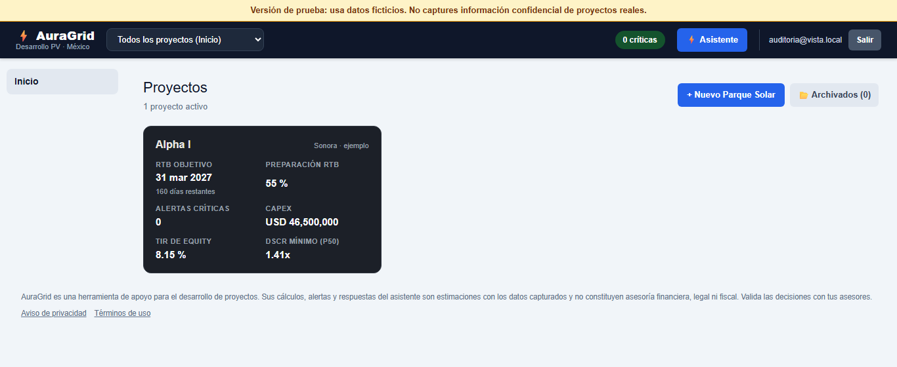
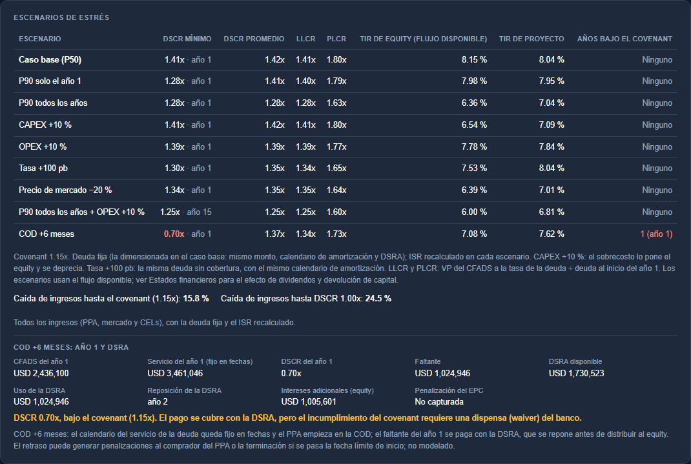
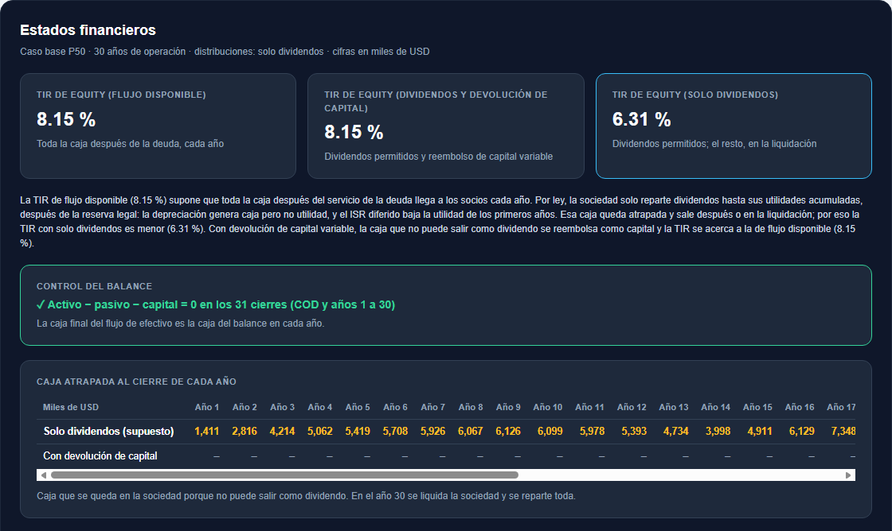
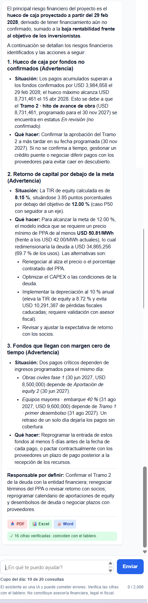
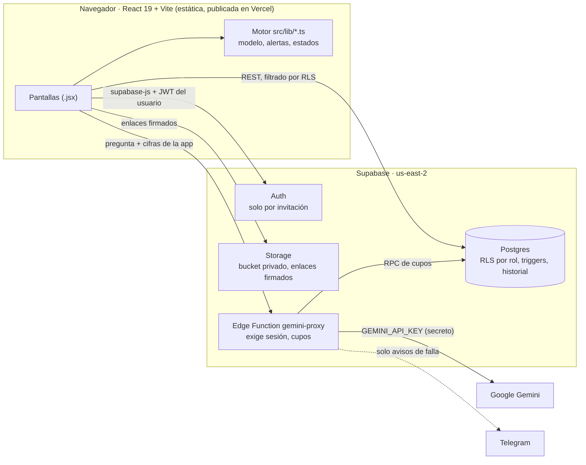

# AuraGrid

Aplicación de gestión de proyectos asistida por IA, construida con React, Supabase y Gemini. Caso de demostración: desarrollo y financiamiento de parques solares fotovoltaicos en México, del terreno al RTB (ready to build).

## De un vistazo

- **IA que explica pero nunca calcula**, con la verificación de cada cifra de cada respuesta contra el tablero.
- **Modelo de tres estados** (resultados, balance y flujo de efectivo) con un balance que cuadra en los 31 cierres.
- **867 pruebas automáticas** y verificación independiente del modelo financiero, celda por celda.
- **Seguridad por rol:** RLS por rol y una auditoría de seguridad antes de publicar.

**Tecnologías:** React 19, Vite, TypeScript, Supabase (Postgres, RLS, Storage, Edge Functions en Deno), Google Gemini, Excel con fórmulas, node:test.

[English](README.md) · **App publicada:** [https://auragrid-ochre.vercel.app](https://auragrid-ochre.vercel.app) · **Acceso demo bajo solicitud:** escríbeme por [LinkedIn](https://www.linkedin.com/in/robertoimb) y te invito como lector · **Video demo (español):** https://youtu.be/84Mc6vZKKPI · **English:** https://www.youtube.com/watch?v=Gs0g8w8QNwo

AuraGrid es para **desarrolladores de parques solares en México** que tienen que llevar un proyecto desde el control del terreno hasta el **RTB** (*ready to build*): los permisos y estudios, las garantías, el modelo financiero que leerán los bancos y la caja para llegar ahí. Cada proyecto tiene un solo espacio donde esas piezas están conectadas. Así, un permiso retrasado, una fianza por vencer o un hueco de caja aparecen junto a las cifras que afectan.

> **Aviso legal.** AuraGrid es una herramienta de apoyo para el desarrollo de proyectos. Sus cálculos, alertas y respuestas del asistente son estimaciones con los datos capturados y no constituyen asesoría financiera, legal ni fiscal. El proyecto de ejemplo (Alpha I) usa supuestos ilustrativos.

## Capturas

| Portafolio (Inicio) | Resumen del proyecto |
|---|---|
|  |  |

| Escenarios de estrés (Finanzas) | Estados financieros (Finanzas) |
|---|---|
|  |  |

| Asistente IA |
|---|
|  |

*Ante la pregunta “¿Cuál es el principal riesgo financiero de Alpha I y qué harías?”, el asistente ordena las alertas del motor y cita sus cifras; la marca al final indica que las 16 cifras de la respuesta coinciden con el tablero.*

## Qué hace

- **Ruta a RTB:** frentes y entregables con responsable, fecha compromiso y evidencia; avance real contra planeado, RTB proyectado y vencidos. Cada cambio queda en un historial que no se puede editar.
- **Garantías:** fianzas y cartas de crédito validadas contra el hito que deben cubrir (RTB, NTP, interconexión, COD) más un margen.
- **Modelo financiero:**
  - CAPEX y usos, con intereses de construcción mes a mes;
  - deuda esculpida por DSCR;
  - TIR de proyecto y de equity, LCOE y precio mínimo de PPA;
  - sensibilidad PPA × CAPEX;
  - cronograma de caja mensual que detecta huecos de fondeo.
- **Estados financieros:** estado de resultados, balance y flujo de efectivo, con los límites legales a los dividendos y la caja atrapada.
- **Alertas del asesor:** un solo motor de validaciones (`src/lib/validaciones.ts`) para plazos, garantías, fondeo, obra antes de permisos, covenants y seguros.
- **Asistente IA (Gemini):** responde sobre el proyecto con las cifras y alertas de la app; cada respuesta se descarga en PDF, Word o Excel.
- **Excel:** un libro protegido, al estilo de un banco, con celdas de control en fórmula que deben dar cero.
- **Equipo:** roles de dueño, editor y lector (para bancos y asesores), con registro de accesos y de exportaciones.

## Decisiones técnicas

- **"La IA explica, nunca calcula."** Todas las cifras salen del motor en TypeScript de `src/lib/`. Gemini recibe esas cifras y las alertas activas como datos, con una instrucción de sistema que le prohíbe calcular, estimar, redondear o convertir (`supabase/functions/_shared/asesor.ts`). Después se revisa cada respuesta: cada cifra se compara con el tablero (`src/lib/verificarCifras.ts`), y la revisión también se aplica en las descargas.
- **La clave de Gemini nunca llega al navegador.** El asistente pasa por la Edge Function `gemini-proxy`. Exige sesión (`verify_jwt = true` y rol `authenticated`) y lee `GEMINI_API_KEY` de los secretos de Supabase. El frontend solo tiene la clave publicable, que es pública por diseño.
- **RLS por rol.** Cada tabla del proyecto está protegida en Postgres: dueño, editor (`project_members`) o lector. Las reglas viven en funciones `SECURITY DEFINER` (`puede_ver`, `puede_editar`, `es_dueno`) con `search_path` fijo y sin permiso de ejecución para `anon` ni `public`. Un lector no puede modificar nada, ni desde la app ni directamente contra la API. El bucket de documentos es privado y entrega enlaces firmados de 10 minutos.
- **Cupos del asistente en la base de datos.** Un cupo global diario de 20 por defecto (configurable), para mantenerse dentro del nivel gratuito de Gemini; una reserva para el dueño (10); y un límite por lector (5, ajustable por persona). Se reinician a medianoche del Pacífico, igual que la cuota de Google. Si Gemini falla, la consulta se devuelve.
- **Auditoría de seguridad antes de publicar (oct 2026).**
  - **Hallazgo crítico:** una política abierta en `solar_projects`, creada a mano en el panel durante el prototipo. Permitía a cualquier usuario con sesión ver, modificar o borrar cualquier proyecto.
  - **Corrección:** se eliminó con una migración, junto con el acceso a las vistas y funciones del prototipo.
  - **Verificación:** las pruebas de permisos actuaron con la identidad de cada rol (lector, sin membresía, editor, dueño, invitado nuevo y sin sesión) en transacciones revertidas. También encontraron un error de cascada: el dueño no podía borrar un proyecto con créditos. Se corrigió en su propia migración.
  - **Otras medidas:** el registro público está apagado (el acceso es solo por invitación) y la app se publica con `noindex`, cabeceras de seguridad y una CSP en modo de reporte.
- **Una sola cadena de cálculo.** `analizarProyecto()` produce todo lo que usan el tablero, las tarjetas de Inicio, el asistente y el Excel: ninguna pantalla calcula su propia versión de una cifra.

## Verificación

- **867 pruebas automáticas** en 42 archivos (`node:test` con tsx), más `tsc` estricto sobre el motor, las pruebas y el código compartido de la Edge Function.
- **Verificación independiente:** el modelo financiero se verificó, celda por celda, contra un modelo de referencia independiente (no incluido en este repositorio). Abarcó:
  - deuda, TIR de equity y DSCR;
  - flujos del IVA;
  - tramos de cada banco;
  - escenarios de estrés, LLCR/PLCR y puntos de quiebre;
  - estados financieros y dividendos.

  Las cifras esperadas están fijas en las pruebas. Por ejemplo, deuda de USD 28,731,461, TIR de equity de 8.15 %, DSCR mínimo de 1.408x, LLCR de 1.414x, y caída de ingresos de 15.8 % hasta el covenant y de 24.5 % hasta 1.0x.
- **Excel con controles en fórmula.** Cada hoja tiene celdas de control (`ROUND(…, 2)` que deben dar 0), en verde o rojo con formato condicional.
  - **Balance:** activo − pasivo − capital = 0, como fórmula, en los 31 cierres (COD y años 1 a 30).
  - **Flujo de efectivo:** la caja final de cada año se amarra al balance con una fórmula entre hojas.
  - **Prueba de fórmulas:** recalcula cada fórmula de las hojas nuevas a partir de las celdas.
  - **Hojas sin cambios:** las hojas existentes se comparan celda por celda contra la versión anterior.

## Dominio (México)

- **ISR:** pérdidas fiscales que caducan a los 10 años (LISR art. 57); deducción inmediata del equipo de generación (art. 34 fr. XIII) o depreciación por categorías; **ISR diferido** (NIF D-4), que solo reconoce las pérdidas que sí se usarán.
- **IVA de construcción:** fechado mes a mes y financiado con equity o con una línea de IVA, con su plazo de recuperación, pico y costo financiero.
- **Dimensionamiento de la deuda:** DSCR sobre P50 y P90, DSCR de mercado para los ingresos sin contrato, tope de apalancamiento y DSRA.
- **Varios bancos:** tasa y comisiones ponderadas, comisión por no disposición y tramos con sus condiciones.
- **Escenarios de estrés:** con la deuda del caso base fija y el ISR recalculado. Incluyen P90 en el año 1 o todos los años, CAPEX +10 %, OPEX +10 %, tasa +100 pb, precio de mercado −20 % y P90 con OPEX +10 %, más LLCR/PLCR y puntos de quiebre de ingresos.
- **COD +6 meses:** servicio fijo en fechas; la DSRA cubre el faltante y se repone antes de distribuir; mensaje de dispensa (waiver) si se incumple el covenant.
- **Riesgos de operación:** disponibilidad, curtailment, reemplazo de inversores con reserva MMRA y lock-up.
- **Dividendos:**
  - reserva legal del 5 % de la utilidad neta hasta el 20 % del capital social (LGSM art. 20);
  - dividendos solo hasta las utilidades acumuladas (art. 19);
  - **caja atrapada**, liquidación al final de la vida útil y devolución de capital variable opcional;
  - tres TIR de equity: flujo disponible, dividendos y devolución de capital, y solo dividendos.

## Arquitectura



## Alcance y limitaciones

- **Modelo anual.** Los estados financieros cubren solo el caso base P50; los escenarios de estrés usan el flujo disponible.
- **Simplificaciones fiscales.** Los intereses de construcción, las comisiones y los costos de la línea de IVA no se deducen del ISR. No hay CUFIN, retenciones a los socios, PTU ni límite de deducción de intereses.
- **Simplificaciones contables.** La comisión de estructuración se presenta neta de la deuda y se amortiza en línea recta; no se da de baja el inversor sustituido; los dividendos se pagan contra las utilidades del mismo año.
- **Devolución de capital variable.** Puede llevar el capital casi a cero; no se modela el capital fijo mínimo de una S.A.P.I. de C.V.
- **Solo USD**, sin tipo de cambio.
- **Versión de prueba.** Usa datos ficticios y no captures información confidencial de proyectos reales. Gemini procesa los datos fuera de México, y en el nivel gratuito Google puede usarlos para mejorar sus productos.

La lista completa está en la hoja *Supuestos* del Excel ("Alcance y limitaciones del modelo") y en la pestaña de Estados financieros.

## Estado: v1 (portafolio)

Esta es la **v1, publicada como proyecto de portafolio**. Muestra la arquitectura, el motor financiero y el enfoque de verificación con un proyecto de ejemplo; funciona como versión de prueba con datos ficticios y no es un servicio en producción.

**Fuera de alcance de esta versión:**

- **Data room:** compartir los documentos de la debida diligencia con bancos y asesores.
- **Buscador de terrenos:** búsqueda y filtrado de sitios por coordenadas, recurso solar por ubicación y exportación KML/KMZ.
- **Modelo financiero v2:** servicio semestral de la deuda, préstamo de socios, CUFIN e ISR por dividendos, límite de deducción de intereses y cobertura de tasa.

No son compromisos ni entregables planeados.

## Sobre el autor

Soy Roberto Imbers, ingeniero industrial (UCA) con un MIM de IE Business School y experiencia en el desarrollo de proyectos solares fotovoltaicos en España y México, de greenfield a RTB. Construí AuraGrid para resolver un problema que viví: el avance de los permisos, las garantías y el modelo financiero suele vivir en archivos separados, y los riesgos aparecen tarde.

**Cómo lo construí.** Desarrollé AuraGrid dirigiendo a un agente de IA para programar (Claude Code) con un método de especificar y verificar: cada fase se definió con criterios de aceptación y cifras esperadas calculadas de antemano, y se revisó con pruebas automáticas, un modelo de referencia independiente y revisiones de seguridad antes de cada cambio a la base de datos.

**Contacto:** [LinkedIn](https://www.linkedin.com/in/robertoimb)

## Correrlo localmente

Requisitos: Node.js 20.19 o superior (probado con 24) y npm.

```bash
npm install
npm run dev        # http://localhost:5173
npm test           # 867 pruebas
npm run typecheck  # tsc estricto
npm run build      # build de producción en dist/
```

`src/supabase.js` apunta al Supabase del proyecto, con su clave publicable; esa clave es pública por diseño y los datos los protege el RLS. Para usar un backend propio:

1. Crea un proyecto en Supabase.
2. Pon su URL y su clave publicable en `src/supabase.js`.
3. Aplica las migraciones con `npx supabase link --project-ref <ref>` y después `npx supabase db push`.
4. Despliega el asistente con `npx supabase functions deploy gemini-proxy --project-ref <ref> --use-api` y configura su secreto con `npx supabase secrets set GEMINI_API_KEY=… --project-ref <ref>`.

## Publicarlo en Vercel y Supabase

La app es estática: Vercel solo sirve `dist/` y **no necesita variables de entorno**. La clave de Gemini vive solo en Supabase. `vercel.json` fija el build, las reglas de la SPA, las cabeceras de seguridad, `X-Robots-Tag: noindex` y una CSP en modo de reporte.

1. **Supabase, antes de publicar:**
   - **SMTP:** configura un SMTP propio (Authentication → Emails → SMTP Settings). El correo integrado solo permite unos pocos envíos por hora.
   - **Plantillas de correo en español:** configura las de *Invite user* y *Reset password* (Authentication → Emails → Templates). El texto está en [docs/plantillas-correo.md](docs/plantillas-correo.md).
   - **Registro público:** comprueba que **Allow new users to sign up** esté apagado.
2. **Vercel:**
   - Add New → Project → importa el repositorio de GitHub.
   - Vercel detecta Vite y ejecuta `npm run build`.
   - Anota la URL o conecta tu dominio.
3. **Supabase → Authentication → URL Configuration:**
   - **Site URL:** la URL de Vercel o tu dominio. Ahí llevan los enlaces de invitación y de recuperación.
   - **Redirect URLs:** `https://<tu-url>/**` y `http://localhost:5173/**`.
4. **Prueba con un segundo correo:**
   - invítate, define la contraseña desde el correo y entra;
   - agrégate a un proyecto como lector y comprueba que sea de solo lectura y que se vea el cupo del asistente;
   - recupera la contraseña;
   - pruébalo en el celular.

La operación (respaldos con `npm run respaldo`, cupos, roles y despliegue de `gemini-proxy`) está en [docs/OPERACION.md](docs/OPERACION.md).

---

© 2026 Roberto Imbers. Todos los derechos reservados
