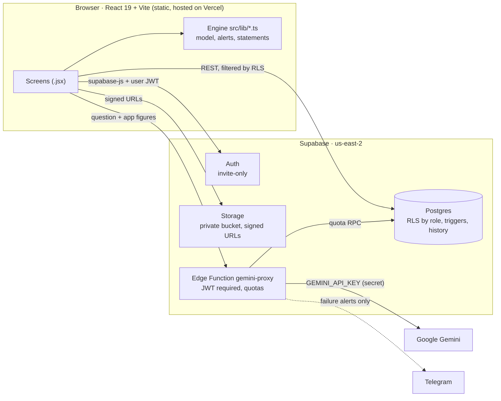

# AuraGrid

AI-assisted project delivery app, built with React, Supabase and Gemini. Demo case: development and financing of utility-scale solar PV in Mexico, from greenfield to ready-to-build.

## At a glance

- **AI that explains but never calculates**, with every figure in each answer checked against the dashboard.
- **Three-statement financial model** (income statement, balance sheet and cash flow) whose balance sheet ties out in all 31 closings.
- **867 automated tests** and an independent, cell-by-cell verification of the financial model.
- **Security by role:** row-level security by role and a security audit before publishing.

**Stack:** React 19, Vite, TypeScript, Supabase (Postgres, RLS, Storage, Edge Functions in Deno), Google Gemini, Excel with formulas, node:test.

[Español](README.es.md) · **Live app:** [https://auragrid-ochre.vercel.app](https://auragrid-ochre.vercel.app) · **Demo access:** on request: message me on [LinkedIn](https://www.linkedin.com/in/robertoimb) and I'll invite you as a reader · **Demo video (English):** https://www.youtube.com/watch?v=Gs0g8w8QNwo · **Español:** https://youtu.be/84Mc6vZKKPI

AuraGrid is for **developers of utility-scale solar parks in Mexico** who have to take a project from site control to **RTB** (*ready to build*): the permits and studies, the guarantees, the financial model the banks will read, and the cash to get there. Each project gets one workspace where those pieces are connected, so a delayed permit, an expiring bond or a funding gap shows up next to the numbers it affects.

> **Disclaimer.** AuraGrid is a decision-support tool. Its figures, alerts and assistant answers are estimates based on the data entered and are not financial, legal or tax advice. The sample project (Alpha I) uses illustrative assumptions.

## Screenshots

| Portfolio (Home) | Project summary |
|---|---|
|  |  |

| Stress scenarios (Finance) | Financial statements (Finance) |
|---|---|
|  |  |

| AI assistant |
|---|
|  |

*Asked “What is Alpha I's main financial risk and what would you do?”, the assistant ranks the engine's alerts and quotes its figures; the badge at the bottom shows the 16 figures in the answer matched the dashboard.*

## What it does

- **Path to RTB:** workstreams and deliverables with owner, due date and evidence; planned vs. actual progress, projected RTB date and overdue items. Every change lands in an append-only history.
- **Guarantees:** bonds and letters of credit checked against the milestone they must cover (RTB, NTP, interconnection, COD) plus a safety margin.
- **Project finance model:** CAPEX and uses with month-by-month interest during construction, debt sculpted to DSCR, project and equity IRR, LCOE, minimum PPA price, PPA × CAPEX sensitivity and a monthly cash schedule that flags funding gaps.
- **Financial statements:** income statement, balance sheet and cash flow, with legal dividend limits and trapped cash.
- **Advisor alerts:** one validation engine (`src/lib/validaciones.ts`) for deadlines, guarantees, funding, construction before permits, covenants and insurance.
- **AI assistant (Gemini):** answers questions about the project using the app's figures and alerts; answers download as PDF, Word or Excel.
- **Excel export:** a protected, bank-style workbook with formula checks that must equal zero.
- **Team access:** owner, editor and read-only roles for lenders and advisors, with an access log and an export log.

## Technical decisions

- **"AI explains, never calculates."** Every number comes from the TypeScript engine in `src/lib/`. Gemini receives those figures and the active alerts as data, with a system prompt that forbids calculating, estimating, rounding or converting (`supabase/functions/_shared/asesor.ts`). Each answer is then checked: every figure in it is matched against the dashboard (`src/lib/verificarCifras.ts`), and the check also runs on the downloaded files.
- **The Gemini key never reaches the browser.** The assistant goes through the Edge Function `gemini-proxy`. It requires a signed-in user (`verify_jwt = true` and the `authenticated` role) and reads `GEMINI_API_KEY` from Supabase secrets. The frontend only holds the publishable key, which is public by design.
- **Row-level security by role.** Every project table is protected in Postgres: owner, editor (`project_members`) or reader. The rules live in `SECURITY DEFINER` helpers (`puede_ver`, `puede_editar`, `es_dueno`) with a fixed `search_path`, and their execute permission is revoked from `anon` and `public`. A reader cannot modify anything, from the app or directly against the API. The document bucket is private and serves 10-minute signed links.
- **Assistant quotas in the database.** A global daily cap of 20 by default (configurable), to stay within the Gemini free tier; a reserve kept for the owner (10); and a per-reader limit (5, adjustable per person). Counters reset at Pacific midnight, like Google's quota. If Gemini fails, the query is refunded.
- **Security audit before publishing (Oct 2026).**
  - **Critical finding:** an open policy on `solar_projects`, created by hand in the dashboard during prototyping. It let any signed-in user read, modify or delete any project.
  - **Fix:** the policy was dropped in a migration, along with access to the prototype's views and functions.
  - **Verification:** permission tests impersonated each role (reader, non-member, editor, owner, new invitee, anonymous) inside transactions that roll back. They also surfaced a cascade bug: an owner could not delete a project that had loans. It was fixed in its own migration.
  - **Other measures:** sign-up is disabled (access is by invitation only), and the app ships with `noindex`, security headers and a report-only CSP.
- **One calculation chain.** `analizarProyecto()` produces everything the dashboard, the Home cards, the assistant and the Excel use, so no screen computes its own version of a number.

## Verification

- **867 automated tests** in 42 files (`node:test` with tsx), plus strict `tsc` over the engine, the tests and the shared Edge Function code.
- **Independent verification:** the financial model was verified, cell by cell, against an independent reference model (not included in this repository). It covered:
  - debt, equity IRR and DSCR;
  - IVA cash flows;
  - each lender's tranche;
  - stress scenarios, LLCR/PLCR and break-even points;
  - financial statements and dividends.

  The expected figures are pinned in the tests. For example, debt of USD 28,731,461, an equity IRR of 8.15 %, a minimum DSCR of 1.408x, an LLCR of 1.414x, and revenue drops of 15.8 % to the covenant and 24.5 % to 1.0x.
- **Excel with checks in formulas.** Every sheet has check cells (`ROUND(…, 2)` that must equal 0), shown in green or red with conditional formatting.
  - **Balance sheet:** assets − liabilities − equity = 0, as a formula, in all 31 closings (COD and years 1–30).
  - **Cash flow:** each year's closing cash is tied to the balance sheet with a cross-sheet formula.
  - **Formula test:** re-evaluates every formula in the new sheets from the cells themselves.
  - **Unchanged sheets:** the existing sheets are fingerprinted cell by cell against the previous release.

## Domain coverage (Mexico)

- **Income tax (ISR):** tax losses that expire after 10 years (LISR art. 57); immediate deduction of generation equipment (art. 34 fr. XIII) or depreciation by asset class; **deferred tax** (NIF D-4), recognized only for the losses that will actually be used.
- **Construction VAT (IVA):** dated month by month and funded with equity or a VAT credit line, with its recovery lag, peak and financial cost.
- **Debt sizing:** DSCR on P50 and P90, a market DSCR for uncontracted revenue, a leverage cap and a DSRA.
- **Multiple lenders:** weighted rate and fees, commitment fees, and tranches whose conditions must be met.
- **Stress scenarios:** base-case debt held fixed and tax recomputed. They cover P90 in year 1 or every year, CAPEX +10 %, OPEX +10 %, rate +100 bp, merchant price −20 % and P90 with OPEX +10 %, plus LLCR/PLCR and break-even revenue drops.
- **COD +6 months:** debt service fixed by date, with the DSRA covering the shortfall and replenished before distributions; a waiver message when the covenant is breached.
- **Operating risks:** availability, curtailment, inverter replacement with an MMRA reserve, and lock-up.
- **Dividends:**
  - legal reserve of 5 % of net income up to 20 % of share capital (LGSM art. 20);
  - dividends only up to retained earnings (art. 19);
  - **trapped cash**, liquidation at end of life, and optional return of variable capital;
  - three equity IRRs: available cash flow, dividends plus capital return, and dividends only.

## Architecture



## Scope and limitations

- **Annual model**, base case P50 for the statements. The statements cover the base case only; stress scenarios use available cash flow.
- **Tax simplifications.** Interest during construction, fees and VAT-line costs are not deducted for tax purposes. There is no CUFIN, dividend withholding, PTU or interest-deduction cap.
- **Accounting simplifications.** The structuring fee is netted against the debt and amortized straight-line; the replaced inverters are not written off; dividends are paid against the same year's earnings.
- **Return of variable capital** can take capital close to zero. The fixed minimum capital of a S.A.P.I. de C.V. is not modeled.
- **USD only**, with no exchange rate.
- **Test version.** Use fictitious data and do not enter confidential information from real projects. Gemini processes data outside Mexico, and the free tier may use it to improve Google's products.

The full list is in the workbook's *Supuestos* sheet ("Alcance y limitaciones del modelo") and in the Financial statements tab.

## Status: v1 (portfolio)

This is **v1, published as a portfolio project**. It shows the architecture, the financial engine and the verification approach on a sample project; it runs as a test version with fictitious data and is not a production service.

**Out of scope for this version:**

- **Data room:** sharing due-diligence documents with lenders and advisors.
- **Land finder:** site search and screening by coordinates, solar resource by location and KML/KMZ export.
- **Financial model v2:** semiannual debt service, shareholder loans, CUFIN and dividend tax, interest-deduction cap and hedging.

These are not commitments or planned deliverables.

## About the author

I'm Roberto Imbers, an industrial engineer (UCA) with a Master in Management from IE Business School and experience developing utility-scale solar PV projects in Spain and Mexico, from greenfield to RTB. I built AuraGrid to solve a problem I lived firsthand: permitting progress, guarantees and the financial model usually live in separate files, so risks surface late.

**How I built it.** I developed AuraGrid by directing an AI coding agent (Claude Code) through a spec-and-verify workflow: every phase was defined with acceptance criteria and expected figures computed in advance, then checked with automated tests, an independent reference model and security reviews before every database change.

**Contact:** [LinkedIn](https://www.linkedin.com/in/robertoimb)

## Run it locally

Requirements: Node.js 20.19 or later (tested with 24) and npm.

```bash
npm install
npm run dev        # http://localhost:5173
npm test           # 867 tests
npm run typecheck  # strict tsc
npm run build      # production build in dist/
```

`src/supabase.js` points to the project's Supabase instance and its publishable key; that key is public by design, and the data is protected by RLS. To run against your own backend:

1. Create a Supabase project.
2. Put its URL and publishable key in `src/supabase.js`.
3. Apply the migrations with `npx supabase link --project-ref <ref>` and then `npx supabase db push`.
4. Deploy the assistant with `npx supabase functions deploy gemini-proxy --project-ref <ref> --use-api` and set its secret with `npx supabase secrets set GEMINI_API_KEY=… --project-ref <ref>`.

## Publish on Vercel and Supabase

The app is static: Vercel only serves `dist/`, and it needs **no environment variables**. The Gemini key lives only in Supabase. `vercel.json` sets the build, the SPA rewrites, the security headers, `X-Robots-Tag: noindex` and a report-only CSP.

1. **Supabase, before publishing:**
   - **SMTP:** set up custom SMTP (Authentication → Emails → SMTP Settings). The built-in mailer only allows a few emails per hour.
   - **Spanish email templates:** set the *Invite user* and *Reset password* templates in Spanish (Authentication → Emails → Templates). The text is in [docs/plantillas-correo.md](docs/plantillas-correo.md).
   - **Sign-up:** confirm that **Allow new users to sign up** is off.
2. **Vercel:**
   - Add New → Project → import the GitHub repository.
   - Vercel detects Vite and runs `npm run build`.
   - Note the URL or attach your domain.
3. **Supabase → Authentication → URL Configuration:**
   - **Site URL:** the Vercel URL or your domain. Invitation and password-reset links point there.
   - **Redirect URLs:** `https://<your-url>/**` and `http://localhost:5173/**`.
4. **Test with a second email:**
   - invite yourself, set the password from the email and sign in;
   - add yourself to a project as a reader and confirm that it is read-only and that the assistant quota shows;
   - reset the password;
   - try it on a phone.

Operations in Spanish, covering backups (`npm run respaldo`), quotas, roles and deploying `gemini-proxy`: [docs/OPERACION.md](docs/OPERACION.md).

---

© 2026 Roberto Imbers. All rights reserved
